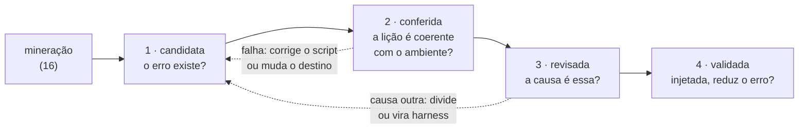

# Validação — da candidata à memória validada

> **Códigos e siglas** (`U_…`/`H_…`, Ajuste N, roadmap #N, `b3 #N`): o que cada um quer dizer está no
> [glossário](../../glossario.md).

**Para que serve este documento:** o que acontece **depois** da mineração. A mineração
([`16-procedimento-mineracao-candidatas.md`](16-procedimento-mineracao-candidatas.md)) termina numa **candidata**: um
arquivo de memória com a lição, o escopo, a evidência e o destino, e com cada número conferido por uma auditoria
independente. Isso prova que **o erro existe, assim e com essa frequência**. Não prova que a lição está certa para o
ambiente, que a causa é a que a regra supõe, nem que a memória, injetada, reduz o erro. Este documento é a escada que
leva a candidata até **memória validada**, em quatro degraus. Vale para qualquer lição, em qualquer base.

Proposto e aprovado em 19/10/2026, depois do piloto do sandbox (`U_sandbox`, base 3): as 14 candidatas do piloto passaram
na mineração, mas a releitura mostrou que várias não estavam prontas — uma mandava importar um módulo proibido em parte
dos papéis, outra mandava chamar uma ferramenta que não existe, outra brigava com o prompt (dossiê do sandbox, §2e;
`decisoes.md`, 19/10).

## Os quatro degraus



| Degrau | A pergunta | Natureza | Como | Sai com |
|---|---|---|---|---|
| **1 · candidata** | o erro existe, assim e com essa frequência? | determinístico | a mineração (`16`): regras sobre a mensagem e a linha que falhou, auditoria independente, encontro medida a medida | o arquivo final e a entrada no catálogo (`registros/memorias.json`) |
| **2 · conferida** | a lição é coerente com o ambiente e com o prompt? | determinístico | as cinco checagens abaixo, por script, sem ler caso | cada memória com as checagens passando, ou a correção decidida |
| **3 · revisada** | a causa é mesmo a que a regra supõe? | investigação com agentes + o pesquisador | leitura de uma amostra por regra fixa: um leitor, um segundo leitor às cegas, concordância medida (skill `mineracao-investigacao`); o gate do pesquisador aprova o texto e o destino | a lição e o destino aprovados, com as palavras do pesquisador |
| **4 · validada** | injetada, ela reduz o erro sem criar outro? | experimento, com medida determinística | primeiro em reprodução (os casos que falharam, de novo, com a memória); depois o teste de compensação, antes × depois, por taxa e por papel (`b3 #39`) | a eficácia medida; **só aqui a candidata vira memória validada** |

**Até o degrau 4, a memória é hipótese com evidência.** O que se pode afirmar em cada degrau é só a pergunta dele.

## Degrau 2 · as cinco checagens

Todas determinísticas, sobre o arquivo final da memória, as listas de imports autorizados (que a mensagem de erro traz)
e o prompt de cada papel. Nenhuma lê texto de caso.

| # | Checagem | A regra | Falha quando | Exemplo (piloto do sandbox) |
|---|---|---|---|---|
| 1 | **coerência com o ambiente** | todo nome que a memória manda usar ou importar existe no papel: está na lista de imports autorizados do papel ou é ferramenta declarada no prompt (os `def`) | a memória manda usar o que o papel não tem | a memória global "importe `pd`" valeria também em papéis sem `pandas` na lista |
| 2 | **conflito com o prompt** | o prompt do papel não manda o contrário do que a memória diz | a memória proíbe o que o prompt pede (ou o prompt manda usar o que a memória diz que não existe) | a memória "não chame `globals`" no papel cujo prompt manda verificar se a variável existe |
| 3 | **repete o prompt** | o conteúdo da memória não está já escrito no prompt do papel | o prompt já diz isso e o agente ignora — a memória repetiria a mesma instrução | a lista de imports autorizados já está nos 16 prompts (base 1) |
| 4 | **recorrência** | a memória passa na régua de memória rara: pelo menos 3 execuções em pelo menos 2 meses | poucos casos: a memória fica monitorada, não injetada | 6 das 14 memórias do piloto |
| 5 | **uma causa só** | a memória não junta sub-causas com consertos diferentes (por exemplo, o mesmo nome barrado usado para depurar e para verificar) | a parte mistura causas: divide-se antes de injetar | a parte E junta a depuração e a verificação com valor padrão |

**O que cada falha pede:** a 1 e a 5 corrigem o script específico (com nova validação pelo `validador-de-script`); a 2
costuma mudar o destino para harness; a 3 e a 4 são decisão do pesquisador (manter, monitorar ou descartar).

**Limite:** as checagens 1 (ferramentas), 2 e 3 precisam do prompt. Numa base sem prompt (a base 3), usa-se o prompt
de uma base com trace completo (base 1 ou 2), do mesmo papel e, se possível, do mesmo período — é aproximação, e o
resultado diz qual prompt usou.

## O que é humano e o que não é

- **Script:** os degraus 1 e 2, e a medida do 4.
- **Agentes, com regra fixa e segundo leitor:** a leitura de casos do degrau 3.
- **O pesquisador:** o destino quando a evidência é ambígua, o texto da lição (gate do degrau 3), a decisão sobre as
  falhas 3 e 4 do degrau 2, o desenho do experimento do degrau 4 e a severidade (`impact`), que espera o gold-standard
  anotado (`b1 #11`).

## Onde o degrau fica registrado

O catálogo das memórias (`analysis/registros/memorias.json`) registra cada memória fechada na mineração, isto é, no
degrau 1. O degrau 2 roda por script (Ajuste 25, 20/10/2026):

```
uv run python analysis/2026-09-trace-law-flow-second/scripts/extrair_prompts_base2.py --trace <trace com prompt> --saida <fora do repo>/prompts.jsonl
uv run python .claude/skills/mineracao-candidata/scripts/conferir_memorias.py --prompts <fora do repo>/prompts.jsonl --saida <conferencia.json> [--registrar]
```

O primeiro extrai o prompt de cada papel e versão (o texto fica fora do repositório); o segundo roda as cinco checagens
sobre o catálogo e, com `--registrar`, grava em cada entrada a `conferencia` (o resultado de cada checagem, o JSONL e a
régua usados) e o `degrau` (2 só se as cinco passam). Os nomes que cada memória manda usar ou evitar vêm do campo
`validation.nomes` do arquivo final (esquema 0.4), que o catálogo copia. A instrução do prompt que induz um nome (a
checagem 2) fica no item do sinal de harness no `monitoramento.json` (`instrucao_prompt`, `nomes_induzidos`).

## O primeiro caso

O sandbox (`U_sandbox`, base 3): 14 candidatas no degrau 1 (19/10). O que falta para o degrau 2 está no
[dossiê](../../2026-10-trace-law-flow-third/propostas/U_sandbox/dossie_base3.md), §2f, e no roadmap da base 3, `b3 #50`.
