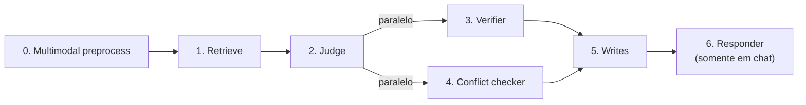

# Conceitos

> Seção: **Conceitos** (página de entrada) · Página original: `docs/conceitos` · [Índice](README.md) · Anterior: [Persistência](04-persistencia.md) · Próxima: [Categorias de memória](06-categorias.md)

Esta seção descreve os conceitos do **motor de memória** — como ele decide o que lembrar, como pondera importância, como rastreia mudanças no perfil do cliente e o que cada estágio do pipeline contribui.

A documentação aqui ignora detalhes de SDK e engenharia (essas estão em [Documentação](01-quickstart.md)). O foco é entender o comportamento do motor o suficiente para configurá-lo, interpretar suas decisões e debugar casos de borda.

## Visão geral do pipeline

Cada turno passa por sete estágios. Os três primeiros são leitura/decisão; os três últimos são escrita/resposta:

- **Estágios 0–1** preparam contexto: enriquecem texto multimodal e recuperam memórias relevantes.
- **Estágio 2** decide o que fazer: o judge LLM emite ações (`insert`, `update`, `respond_only`).
- **Estágios 3–4** validam essas ações em paralelo: o verifier mede qualidade, o conflict checker procura contradições.
- **Estágio 5** persiste tudo.
- **Estágio 6** roda só quando você usa `client.chat()` — gera a resposta para o usuário com as memórias em contexto.

## Tópicos

- [Categorias de memória](06-categorias.md)
- [Scoring de importância](07-scoring.md)
- [Histórico vinculado e duplicatas](08-historico-duplicatas.md)
- [Pipeline do motor](09-pipeline.md)
- [Ações do judge](10-acoes-judge.md)
- [Guarda temporal](11-guarda-temporal.md)
- [Pré-processamento multimodal](12-multimodal.md)

> **Nota de transcrição:** no site, os tópicos aparecem como cards, e a foto só mostra o começo deles. Esta lista segue a ordem da navegação "Anterior/Próxima" entre as páginas.
