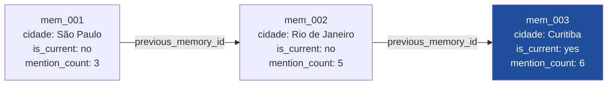

# Histórico vinculado e duplicatas

> Seção: **Conceitos** · Página original: `docs/conceitos/historico` (caminho inferido; a URL não aparece na foto) · [Índice](README.md) · Anterior: [Scoring de importância](07-scoring.md) · Próxima: [Pipeline do motor](09-pipeline.md)

O motor nunca sobrescreve memórias. Em vez disso, ele rastreia a evolução de cada tópico via uma **lista encadeada** de versões, e detecta repetição da mesma informação para reforçar a memória existente sem criar duplicatas.

## Histórico vinculado (linked-history)

Quando uma memória existente precisa ser atualizada — por exemplo, "o cliente se mudou de São Paulo para o Rio de Janeiro" — o motor:

1. Localiza o nó "atual" pela combinação `categoria` + `subject_key` + `is_current = "yes"`.
2. **Demove** o nó anterior: `is_current = "no"`. Mantém o mesmo `id`.
3. **Cria** um novo nó com `is_current = "yes"` e `previous_memory_id` apontando para o id do anterior.
4. Herda `mention_count` do anterior (+1) e zera `conflict_count`.



> **Nota de transcrição:** no diagrama original, as setas vão do nó mais antigo para o mais novo e levam o rótulo `previous_memory_id`. Pelo texto, porém, é o nó novo que guarda o `previous_memory_id` do anterior. O nó atual (`mem_003`) aparece destacado.

Apenas o nó com `is_current = "yes"` é considerado ativo. Os anteriores ficam preservados — úteis para auditoria, raciocínio temporal ("antes de morar em Curitiba, ele morou no Rio") e desfazer mudanças sem perder o contexto.

## Como o motor encontra o nó atual

A busca segue uma cascata:

1. **Por id explícito** — se o judge emitiu `target_memory_id`, o motor usa esse id (depois de validar que o `subject_key` bate).
2. **Por filtro** — `categoria + subject_key + is_current = "yes"`.
3. **Por similaridade** — última opção: top-5 da categoria, filtrando candidatos cujo `subject_key` não confere; sem `subject_key`, exige similaridade textual mínima de 0.25.

Se nenhuma das três encontra um nó anterior, o UPDATE vira efetivamente um INSERT (novo nó isolado).

## Detecção de duplicatas

No INSERT, antes de gravar, o motor:

1. Busca a memória mais similar na **mesma categoria** via embedding similarity.
2. Compara o texto da candidata com o texto existente usando `SequenceMatcher` (similaridade textual em `[0, 1]`).
3. Se a similaridade for **> 0.85**, considera duplicata: incrementa `mention_count` da existente, atualiza `last_mentioned_at` e `user_confirmed`, mas **não cria** novo registro.

O resultado é que repetir o mesmo fato muitas vezes — e.g. o usuário dizer o nome em sessões diferentes — fortalece a memória existente em vez de poluir o banco.

A diferença com UPDATE é importante:

| Operação | Quando ocorre | O que faz |
|---|---|---|
| **Duplicata** | Texto quase idêntico ao existente. | Incrementa `mention_count` da existente. Não cria novo registro. |
| **UPDATE** | Texto **substitui** valor anterior (mudou de cidade, mudou de estado civil). | Cria novo nó com `is_current = "yes"` e demove o anterior. |

A decisão entre os dois é do judge no estágio 2.

## Conflitos vs. histórico vinculado

Histórico vinculado é o caminho **cooperativo** — o usuário declara "agora moro em Curitiba", e o motor encadeia as versões. Conflitos são o caminho **adversarial** — o motor detectou que uma nova INSERT contradiz uma memória atual sem que o judge tenha pedido UPDATE. Nesse caso:

- O conflict checker (estágio 4) marca os ids conflitantes da memória atual.
- Ao escrever a nova INSERT, o motor demove os conflitantes para `is_current = "no"`, incrementa seus `conflict_count` e os linka via `conflicting_memory_ids`.
- A nova INSERT vira o registro vigente.

Isso evita que duas memórias contraditórias coexistam ambas como `is_current = "yes"`.

## Inspecionando histórico

```python
all_memories = client.get_all_memories()

for mem in all_memories:
    meta = mem["metadata"]
    print(
        f"{mem['id']} | {meta.get('categoria')}.{meta.get('subject_key')} | "
        f"is_current={meta.get('is_current')} | "
        f"prev={meta.get('previous_memory_id')}"
    )
```

Para reconstruir uma cadeia, siga `previous_memory_id` recursivamente a partir do nó com `is_current = "yes"`.
