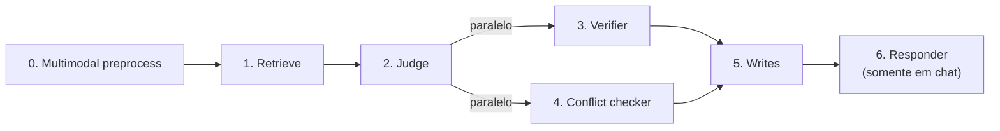

# Pipeline do motor

> Seção: **Conceitos** · Página original: `docs/conceitos/pipeline` · [Índice](README.md) · Anterior: [Histórico vinculado e duplicatas](08-historico-duplicatas.md) · Próxima: [Ações do judge](10-acoes-judge.md)

Cada turno passa por sete estágios. Esta página cobre cada um, com foco em **o que o motor faz e por quê**.



## 0. Pré-processamento multimodal

**Quando roda:** sempre que o turno tem `attachments` (imagem ou áudio em base64).

**O que faz:** chama o LLM `multimodal` com instruções específicas conforme o tipo de mídia:

- **Áudio:** transcreve fielmente, sem resumir, e adiciona uma seção `[AUDIO ANALYSIS]` com idioma detectado, tom de voz, estado emocional, ritmo da fala e cues paralinguísticos (suspiros, risos, pausas).
- **Imagem:** descreve sujeito principal, texto/números visíveis, cores, objetos, pessoas (idade aproximada, expressão, postura), ambiente, marcas/logos, tipo de documento.

A saída é concatenada ao texto do usuário (formato `<texto> + [ATTACHMENT CONTENT] + <descrição>`) e segue para o estágio 1.

**Falha grácil:** se a chamada multimodal lançar exceção, o estágio retorna o texto puro (ou um marcador `[multimodal preprocess failed; ...]` se não havia texto). O motor loga o erro mas não interrompe o turno.

## 1. Retrieve

**O que faz:** busca memórias relevantes no ChromaDB por categoria, rerankeia por `W_global` e seleciona os topos para serem passados ao judge.

A busca é **per-categoria, não única**:

- Para cada uma das 5 categorias, query top-K com `where={"categoria": <cat>}`.
- `K_candidate = ceil(B[cat] × 2)`, `K_selected = ceil(K_candidate / 2)`. Categorias com peso B maior contribuem com mais resultados.
- Para cada candidato, recalcula `W_global` ao vivo (a recência muda com o tempo).
- Reranqueia por `W_global` e seleciona os top da categoria.
- Junta as seleções de todas as categorias.

**Reforço de recuperação:** memórias finais cuja distância de embedding ≤ `reinforce_distance_threshold` (default `0.60`) e cujo cooldown (default 600s) já expirou recebem bump de `mention_count` e refresh de `last_mentioned_at`. É como o motor faz memórias úteis ganharem importância sozinhas.

Detalhes de scoring em [Conceitos → Scoring](07-scoring.md).

## Guarda temporal

Entre os estágios 1 e 2, uma checagem **determinística** (sem LLM) detecta inconsistências:

- "I will buy a car in 2020" — phrasing futuro com ano passado.
- "I bought a car in 2030" — phrasing passado com ano futuro.

A heurística usa lista de marcadores em inglês e português (`will`, `going to`, `bought`, `comprei`, `previsto`, etc.) combinada com extração de ano de quatro dígitos.

**Quando dispara:** o pipeline curto-circuita. O motor responde uma pergunta de esclarecimento ao usuário ("você quis dizer que vai acontecer em 2025 ou que já aconteceu em 2020?") e marca o turno como `pending_temporal`. Nenhuma memória é gravada nesse turno.

**Próximo turno:** a resposta do usuário é processada normalmente, mas o judge recebe a clarificação pendente como contexto. Isso evita persistir um fato com data ambígua.

Página dedicada: [Guarda temporal](11-guarda-temporal.md).

## 2. Judge

**O que faz:** o LLM `judge` lê a USER INPUT, o histórico de curto prazo e as memórias recuperadas, e emite uma lista de ações em JSON estrito:

```
{
  "actions": [
    {
      "type": "insert" | "update" | "respond_only",
      "text": "string",
      "feedback": "short string",
      "category": "fixed_profile" | "dynamic_profile" | "preferences" | "events" | "experiences" | null,
      "subject_key": "snake_case" | null,
      "target_memory_id": "string" | null
    }
  ]
}
```

**Decisões importantes:**

- Pode emitir múltiplas ações por turno (e.g. um UPDATE de cidade + um INSERT de evento na mesma fala).
- **Reaproveita `subject_key`** quando as memórias recuperadas mostram um para o mesmo tópico — evita variantes (`current_city` vs. `cidade_atual` vs. `address`).
- Prefere UPDATE sobre INSERT em tópicos mutáveis (cidade, estado civil, emprego, preferências).
- Recusa tópicos sensíveis (`política`, `religião`, etc.) com `respond_only`.

## 3. Verifier (paralelo a 4)

**O que faz:** o LLM `verifier` avalia em batch todas as ações de `insert`/`update` propostas pelo judge. Para cada ação, devolve scores em oito dimensões:

| Dimensão | Pergunta |
|---|---|
| `faithfulness` | A memória preserva o significado do user input? |
| `scope_completeness` | Captura o essencial do tópico atribuído? |
| `hallucination_risk` | Quanto risco há de adicionar info não suportada? |
| `category_fit` | A categoria escolhida é apropriada? |
| `subject_fit` | O `subject_key` é estável e fiel ao tópico? |
| `temporal_fit` | Tempo, tense e estado atual/passado/futuro estão preservados? |
| `polarity_fit` | Negação e sentimento estão preservados? |
| `atomicity` | A memória é mono-tópico? |

Esses scores compõem `q_m` ([fórmula em Scoring](07-scoring.md#q--confiança-do-extrator)), que vira o fator Q no `W_global` da memória.

**Por que existe:** o judge é otimizado para decisão; o verifier é otimizado para skepticism. Ele recebe instruções explícitas para ser estrito, e seus scores degradam memórias mal extraídas no ranking sem precisar deletá-las.

## 4. Conflict checker (paralelo a 3)

**O que faz:** o LLM `conflict` examina cada ação de `insert` e procura, entre as memórias atuais (`is_current = "yes"`) da mesma categoria, registros que **contradizem semanticamente** a nova proposta.

Para cada INSERT proposto, retorna:

```
{
  "action_index": 1,
  "has_conflict": true,
  "conflict_count": 1,
  "conflicting_memory_ids": ["mem_..."],
  "reason": "..."
}
```

**Não conta como conflito:**

- Concordância ou suporte.
- Sobreposição normal de tópicos.
- Memórias antigas (`is_current = "no"`) — apenas as atuais são consideradas.

**Efeito no estágio 5:** ids retornados são demovidos para `is_current = "no"` na hora da escrita, têm `conflict_count` incrementado e são linkados à nova memória via `conflicting_memory_ids`.

## 5. Writes

**O que faz:** roda em paralelo (um worker por ação) e persiste:

- **INSERT:** detecta duplicata via `SequenceMatcher` (> 0.85 → só incrementa `mention_count` da existente); demove memórias conflitantes apontadas pelo conflict checker; grava o novo registro com `W_global` calculado.
- **UPDATE:** encontra o nó atual por `target_memory_id` ou `subject_key`; demove para `is_current = "no"`; cria novo nó com `is_current = "yes"` e `previous_memory_id` linkado.

Detalhes em [Histórico vinculado e duplicatas](08-historico-duplicatas.md).

## 6. Responder

**Quando roda:** apenas quando você chama `client.chat()` (não em `store_memories`).

**O que faz:** o LLM `responder` recebe o system prompt configurado (persona, tom, guardrails), o histórico de curto prazo, o user input enriquecido, as memórias recuperadas e um sumário das ações de memória executadas, e gera a resposta final ao usuário.

**Guardrails padrão:** o responder é instruído a:

- Não inventar fatos.
- Pedir esclarecimentos curtos quando faltar info.
- Não mencionar "memórias", "ChromaDB", "ferramentas" ou detalhes internos.
- Recusar tópicos sensíveis.

Persona e tom podem ser sobrescritos via `prompts.yaml` ([Configuração](03-configuracao.md#customização-de-prompts-promptsyaml)).

## Paralelismo

Dois pontos de paralelismo:

1. **Estágios 3 e 4** rodam em `ThreadPoolExecutor(max_workers=2)`. Verifier e conflict checker são independentes — não precisam esperar um pelo outro.
2. **Estágio 5** roda um thread por ação de escrita. INSERTs e UPDATEs paralelos são seguros porque cada um afeta nós distintos do `subject_key`.

Stages 0–2 e 6 são sequenciais — cada um depende da saída do anterior.
