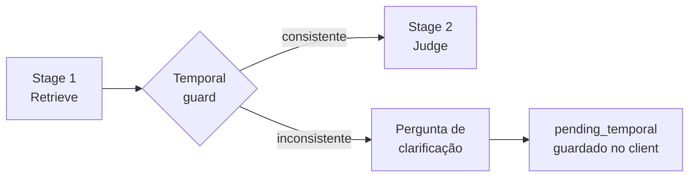

# Guarda temporal

> Seção: **Conceitos** · Página original: `docs/conceitos/guarda-temporal` · [Índice](README.md) · Anterior: [Ações do judge](10-acoes-judge.md) · Próxima: [Pré-processamento multimodal](12-multimodal.md)

A **guarda temporal** é uma checagem determinística — sem chamada de LLM — que roda entre os estágios 1 e 2 do [pipeline](09-pipeline.md). Ela existe para impedir que o motor persista uma memória com data ambígua quando o usuário mistura tempo verbal e ano de forma inconsistente.

## Por que existe

LLMs podem extrair memórias formalmente coerentes mas factualmente confusas a partir de frases como:

"I will buy a car in 2020."

Sem contexto, o judge pode acabar gravando "the user will buy a car in 2020" como evento futuro — o que é falso, já que 2020 está no passado. Em vez de confiar no judge para detectar todos esses casos, o motor faz uma triagem barata e determinística antes de chamá-lo: se houver inconsistência clara, **curto-circuita** o pipeline e pede confirmação ao usuário.

## Como funciona

A heurística vive em `memory_sdk/pipeline/temporal_guard.py` e usa três sinais combinados:

1. **Marcadores de futuro** (PT/EN): `will`, `going to`, `expected`, `due`, `should be`, `will be`, `expected to be`, `previst`, `previsto`.
2. **Marcadores de passado** (PT/EN): `bought`, `i bought`, `purchased`, `i purchased`, `i got`, `was`, `were`, `did`, `last year`, `yesterday`, `comprei`, `eu comprei`, `foi`, `era`, `ontem`, `ano passado`.
3. **Ano de quatro dígitos** capturado pela regex `\b(19\d{2}|20\d{2})\b`.

A guarda dispara em dois casos:

| Caso | Padrão | Exemplo |
|---|---|---|
| `future_past_year` | Marcador de futuro + ano < `current_year` | "I will buy a car in 2020." |
| `past_future_year` | Marcador de passado + ano > `current_year` | "I bought a car in 2030." |

Sem ano explícito ou sem nenhum marcador, a guarda **não** dispara — passa transparente para o judge.

## O que acontece quando dispara



Quando inconsistente:

1. O pipeline **não chama o judge**. Nenhum verifier, nenhum conflict checker, nenhum write.
2. O motor monta uma pergunta de clarificação específica para o caso (e.g. "você quis dizer que vai acontecer em 2025 ou que já aconteceu em 2020?") e a devolve como `reply` da chamada `chat()`.
3. As ações executadas no turno se resumem a um único `respond_only` com feedback "Temporal inconsistency detected; requested user confirmation."
4. O cliente armazena um flag `_pending_temporal` com `kind`, `original_text`, `mentioned_year`, `current_year` e `asked_at`.

## Próximo turno

Na chamada seguinte de `chat()`, o cliente **consome** o `_pending_temporal` armazenado e o injeta no prompt do judge como contexto extra:

```
PENDING_TEMPORAL_CLARIFICATION:
{"kind": "future_past_year", "original_text": "...", "mentioned_year": 2020, ...}
```

A resposta do usuário é então processada normalmente pelo pipeline — o judge agora tem informação suficiente para decidir entre `insert`/`update`/`respond_only` sem ambiguidade. Após esse turno, o flag é zerado.

A guarda só roda dentro de `chat()`. `store_memories()` não usa `_pending_temporal` — em fluxos de extração pura sem responder, a heurística ainda dispara, mas não há onde devolver a clarificação ao usuário.

## Limites conhecidos

- **Falsos negativos.** Frases sem marcador explícito ("Em 2020, comprei um carro" — passado idiomático sem verbo no passado dos marcadores) podem passar batido. A guarda é otimizada para **alta precisão e custo zero**, não para cobertura total.
- **Heurística estritamente lexical.** Não entende negação, condicionais, citação ou hipóteses ("se tivesse comprado em 2020"). O judge ainda é a linha final de defesa nesses casos.
- **Anos fora de `19xx`/`20xx`** não são extraídos.

A guarda é determinística por design: previsibilidade e custo zero importam mais que cobertura aqui — o judge cobre os casos que escapam, e o verifier (via dimensão `temporal_fit`) penaliza memórias com tempo verbal mal preservado.

## Onde é usada

Ver também:

- [Pipeline do motor](09-pipeline.md#guarda-temporal) — onde a guarda se encaixa entre Retrieve e Judge.
- [Ações do judge](10-acoes-judge.md#respond_only) — como `respond_only` é emitido neste fluxo e como o judge consome a clarificação no turno seguinte.
